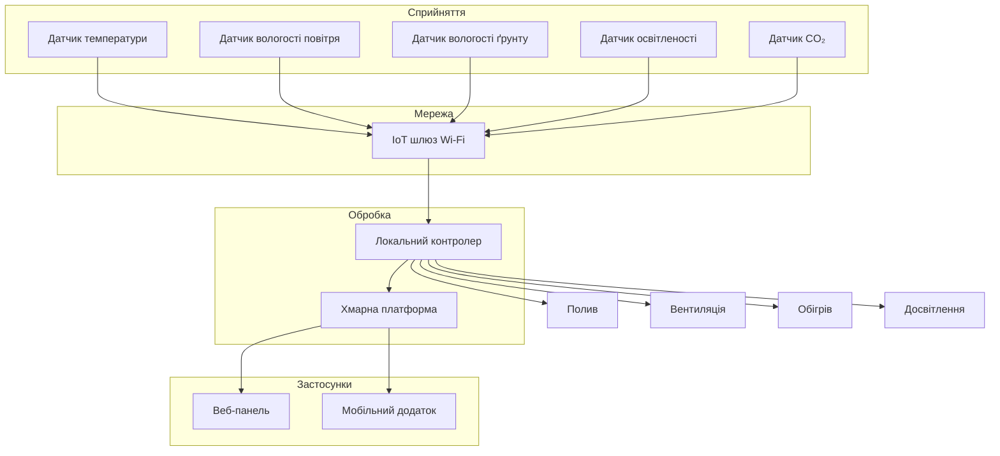

# Практична робота 1. Вступ до IoT та SMART-технологій

## Варіант 1. Розумна теплиця

### Опис системи

Спроєктовано IoT-систему автоматичного контролю теплиці площею 200 м^2.

Система контролює:
температуру;
вологість повітря;
вологість ґрунту;
освітленість;
рівень CO2.

Система керує:
поливом;
вентиляцією;
обігрівом;
досвітленням.

---

## Архітектура системи

---

## Склад системи

| Пристрій | Що вимірює або робить | Де розміщено |
|-----------|-----------|-----------|
| Датчик температури | Вимірює температуру | Усередині теплиці |
| Датчик вологості повітря | Вимірює вологість | Усередині теплиці |
| Датчик вологості ґрунту | Контролює вологість ґрунту | У грядках |
| Датчик освітленості | Вимірює рівень освітлення | Під стелею |
| Датчик CO₂ | Контролює концентрацію CO₂ | У центрі теплиці |
| Насос поливу | Виконує полив | Технічна зона |
| Вентилятор | Здійснює вентиляцію | Бічна стіна |
| Обігрівач | Підтримує температуру | Усередині теплиці |
| LED-лампи | Забезпечують досвітлення | Під стелею |

## Обробка даних
Для системи використано підхід Edge + Cloud.
### Edge
Локальний контролер виконує:
керування поливом;
керування вентиляцією;
керування обігрівом;
керування досвітленням;
аварійні сценарії
Обробка розміщена на Edge, оскільки допустима затримка не повинна перевищувати 1 секунду

### Cloud

У хмарі виконуються:
довгострокове зберігання даних;
статистичний аналіз;
формування звітів;
віддалений доступ через веб-панель та мобільний застосунок

## Робота при втраті зв’язку з хмарою

У випадку втрати доступу до хмарної платформи локальний контролер продовжує працювати автономно

Система:
збирає дані з датчиків;
підтримує встановлені параметри середовища;
зберігає дані локально

Після відновлення зв’язку накопичені дані передаються до хмари

## Оцінка добового обсягу телеметрії
Період опитування датчиків: 1 раз на хвилину
Кількість датчиків: 5
Кількість вимірювань на добу:
5 * 1440 = 7200 записів
Середній розмір одного запису: 20 байт
Добовий обсяг:
7200 × 20 = 144000 байт ≈ 140 КБ

## Безпека
### Загроза 1. Несанкціонований доступ до системи

Захист:
складні паролі;
двофакторна автентифікація;
розмежування прав доступу.

### Загроза 2. Підміна даних датчиків

Захист:
TLS-шифрування;
автентифікація пристроїв.

### Загроза 3. Втрата мережевого з’єднання

Захист:
локальна edge-обробка;
локальне зберігання даних;
автоматична синхронізація після відновлення зв’язку.

## Джерела

1. ITU-T Y.2060 – Overview of the Internet of Things
2. NIST – Considerations for Managing IoT Cybersecurity
3. ENISA – Baseline Security Recommendations for IoT
4. MQTT Version 5.0 Specification.
5. https://mermaid.js.org

Дата звернення: 06.10.2026
